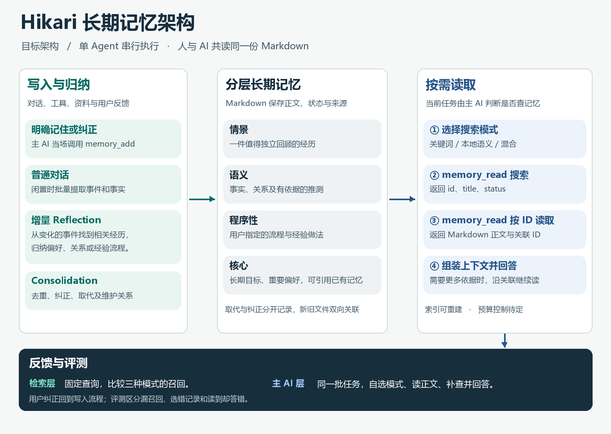

# Hikari 长期记忆架构

2026-11-06 · 已讨论的目标架构，供分层实施和验收使用。当前服务的行为见[现有架构](ARCHITECTURE.md)。本文中的例子均为虚构。

2026-11-07 第一层已实施，最终格式、存储接口与故障验收见 [Markdown 存储与关系](MEMORY_STORAGE.md)。本轮确认覆盖本文早期约定：无独立 status 字段，状态线索从结构化关系与有效时间生成；取消新格式主动撤销，保留数据库账本、快照和故障恢复；不做旧测试记忆迁移。后续层表中的撤销入口不再适用于新格式。第一层不包含检索、闲置提取或主 AI 接入。

## 1. Markdown 中保存什么

Markdown 是记忆的最终载体。仅凭记忆目录，应能恢复每条记忆的身份、正文、性质、状态、关系和来源线索。人和 AI 读同一份内容，每轮任务只按需读取。原件允许缺失，记忆仍可使用，但应能区分当时的记录和现在可以核验的原文。引用资料仍须实际读取并核对版本。

| 类型 | 表达的知识 | 使用方式 |
| --- | --- | --- |
| 情景记忆 | 一件值得独立回顾的经历，可以跨越多轮 | 保留情境、经过和结果，支持追溯 |
| 语义记忆 | 事实与关系，包括明确陈述和有依据的归纳 | 可直接提取，也可由多个情景归纳；标明事实、用户反馈或推测 |
| 程序性记忆 | 适用条件和操作流程 | 用户指定的流程按条件默认采用；从经历归纳的经验做法由主 AI 按任务选用 |
| 核心记忆 | 长期目标、重要偏好等 | 可以引用已有记忆，主 AI 仍按需读取 |

情景和从中归纳的语义结论各自保存、独立可查，通过关系追溯。用户提出了三次类似请求，是三次具体经历；从中推测长期偏好，要能标明推测并指回相关经历。讲解过的内容不能当作已经掌握的证据。

**演变与纠错。** 新旧结论分别保存在两份文件中，双方显式记载关系。若三月的选择到六月才改变，旧决定在三月有效，六月的新决定“取代”它。若三月记录的理由原本就写错，后来的记录“纠正”它。用普通编辑器单独打开旧文件，也能看到后续去向。

**维护入口。** 用户用自然语言提出修改，界面提供查看、修订和无冲突撤销。目标设计取消“手动编辑过就永久锁住整份文件”的做法。具体的并发检测、双向写入中断恢复和旧保护状态迁移，在存储层讨论；实施时须协调项目现有的手工编辑优先约定。

## 2. 写入与整理

| 时机 | 负责的工作 |
| --- | --- |
| 用户明确要求记住或纠正 | 主 AI 当场调用 `memory_add`；需要定位旧记录时先查再写 |
| 普通对话闲置 | 同一 Agent 批量提取值得保留的事件、事实及来源，形成候选并走同一写入入口 |
| 事件新增或纠正 | Reflection 只检查本次变化、相关旧经历及依赖它们的归纳；允许保存标明依据的推测或经验做法 |
| 应用变更 | Consolidation 识别重复、更新、纠正和关系；存储层负责可追溯修订及双向关系一致性 |

Extraction、Consolidation、Reflection 是职责划分，可以共用一次闲置整理，不要求各自独立调用模型。保持单 Agent 串行。明确写入的工具结果可能产生一次模型往返；闲置批次沿用额外的模型请求。新增调用应记录次数和用量，避免记录私人正文。

## 3. 读取与上下文

**Controller 的决定由主 AI 作出。** 收到任务后，自行判断是否查记忆、用什么查询和模式、是否沿链接补读。它对外只需要下列两个记忆工具。表中是行为约定，参数名及序列化格式由实施层确定。

| 操作 | 输入意图 | 结果与责任 |
| --- | --- | --- |
| `memory_read` 搜索 | 查询 + 主 AI 明确选择的关键词、语义或混合模式 | 返回结构化候选，首版字段为 `id`、`title`、`status` |
| `memory_read` 按 ID 读 | 已选中的 ID | 返回对应 Markdown 正文及关联 ID。主 AI 可继续查读 |
| `memory_add` | 新记忆，可指明取代或纠正的旧记忆 | 写入新文件；涉及替代或纠正时同步记录反向关系，进入修订记录 |

Retrieval 负责找候选，Context Assembly 负责组织本次工具返回的候选或正文、状态及关系，让主 AI 能区分搜索线索和实际读到的内容。**预算控制待定**，本阶段不设跨调用预算机制。排序、去重和融合算法在检索实验中比较。

首版同时验证三种模式，语义检索先测本地 Embedding。生成或更新索引消耗本机计算和磁盘，语义查询还需要编码问题。关键词与向量索引均可从 Markdown 重建；是否使用 SQLite 及向量如何持久化留给检索层。该约定只针对记忆索引，现有聊天、任务等应用数据另行管理。

## 4. 如何判断哪一层需要改

1. **检索实验。** 固定记忆快照、查询和候选数量，分别跑关键词、语义和混合检索，标注并检查必要记录是否全部出现。
2. **主 AI 实验。** 在同一批任务中让主 AI 自选模式、挑选 ID、读正文、补查并回答。分别记录缺证据、用错时间版本、候选选错和读到却答错等情形。与无长期记忆和现行方案对照，检验最终回答是否受益。

题目覆盖跨聊天偏好更新、学习续接、决策回溯、跨事件归纳、资料缺失和无关问题。除回答质量外，记录无关注入量、模型调用和 Token、本地检索延迟、索引体积与内存。反馈用于错误归因和改进；用户纠正可触发修订。合成数据适合验证接口，真实模型表现和 N100/N150 性能分别实测。

## 5. 交接：每个对话完成一层

当前基线为提交 `23c9042`。[Memory](../hikari/memory.py) 按整份 Markdown 排序、截取和保护，文件身份、来源和修订依赖数据库。[Agent](../hikari/agent.py) 回答前自动装入记忆，闲置时将全部记忆送去批量整理。[资料库](../hikari/library.py) 已有中文分词、FTS5 和原件核验，可以复用经验。以下是建议实施顺序，每层先做最小版本并验收，再进入下一层。

| 对话 | 范围 | 最小验收 |
| --- | --- | --- |
| ① 存储与关系 | 确定 Markdown 最小格式、稳定 ID、状态、来源、双向关系、修订恢复和兼容读取策略 | 用合成的旧决定、新决定和一次纠错验证；删除派生索引后，仍能从文件辨别当前、历史和纠错关系 |
| ② 读取与检索 | 单独验证搜索和按 ID 读取，建立三种模式及本地向量基线 | 同一批查询对照三种候选集，打开命中 ID 与 Markdown 正文一致 |
| ③ 写入与整理 | 明确写入、闲置提取、合并与增量归纳 | 相同请求重试不重复写；纠正事件后能复核关联推测，修订可无冲突撤销 |
| ④ 主 AI 接入 | 接入两个工具、AI 自选模式及补查、按需组装上下文，接入查看与撤销 | 真实入口可用自然语言查询、纠正及续接；答案可以追到实际读取内容 |
| ⑤ 端到端评测 | 固定题集、盲评回答、检查反馈与资源用量 | 区分检索失败和 AI 选择或使用失败；报告基线对照及目标机器实测范围 |

**实施层待定。** YAML 字段和文件布局、迁移与恢复细节、Embedding 模型、关键词与向量融合、冲突处置细则和验收阈值，均须在对应对话讨论。全库回顾作为后续可选能力；多模态先保留通过来源关联事件与独立媒体资产的方向。本轮不扩张邮件等场景的读取权限。原件只读，个人数据与密钥不得入 Git；测试与预览置于 `local/`。
